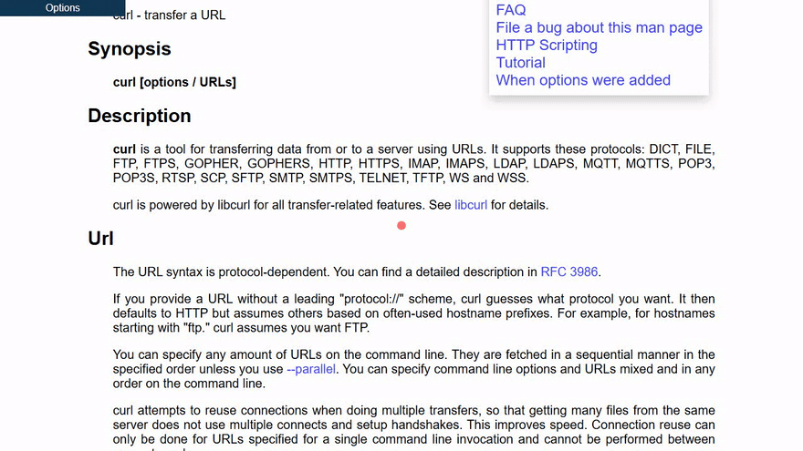

# curl Man Page Option Search

A working preview of a proposed change to [curl-www](https://github.com/curl/curl-www): a search box
in the option menu of [curl's man page](https://curl.se/docs/manpage.html). The menu lists all
command line options. The search box filters the list as you type, so finding an option no longer
means scrolling through a few hundred entries.

**Preview:** <https://jhauga.github.io/curl-manpage/>



## What the Proposal Changes

Three files in curl-www. The full change is [proposal/curl-www.patch](proposal/curl-www.patch).

| File | Change |
| --- | --- |
| [docs/_option-menu.html](proposal/docs/_option-menu.html) | The search box, its styles, and a `<script src="option-search.js" defer>` |
| [docs/option-search.js](proposal/docs/option-search.js) | New: the filter, about 45 lines with no dependencies |
| [docs/.htaccess](proposal/docs/.htaccess) | A Content-Security-Policy for `manpage.html`: the site default with `script-src 'self'` added |

What the search box does:

- A search box at the top of the option menu filters the options while typing, case-insensitive.
- Enter goes to an exact match such as `-k` or `insecure`, or else to the first option shown. Escape
  clears the search.
- The menu stays open while the search box has focus, and it can be opened and browsed by keyboard.
  Clicking an option still closes the menu, as before.
- The search box uses the colors of the dropdown links, in light and dark mode.
- The menu itself stays plain CSS. The script only adds the filter. The search box is hidden in the
  markup and shown by the script, so without JavaScript the menu works as before.

The default CSP on curl.se allows no scripts, and pages that need one get their own policy, as the
`dev/` pages do. The man page policy only adds `script-src 'self'`, and keeps
`require-trusted-types-for 'script'`.

The menu links for `-#` and `-:` have no target, on curl.se as well as here: roffit names both of
those man page anchors `-` ([bagder/roffit#42](https://github.com/bagder/roffit/issues/42)).

## Built From

The preview is the page curl-www builds, with the proposal applied. It is not edited by hand.

| Part | Version |
| --- | --- |
| curl | 8.23.1-DEV ([b5ca96a441](https://github.com/curl/curl/commit/b5ca96a441)), after the 8.23.0 release |
| curl-www | [00577b2e](https://github.com/curl/curl-www/commit/00577b2e) |
| roffit | 0.18 |
| Options in the menu | 278 |
| Built | 2026-10-22 |

[demo-build.json](demo-build.json) holds the same values.

## Repository Layout

| Path | What it is |
| --- | --- |
| `index.html`, `assets/` | The built page and the styles and icons it uses. Generated. |
| `demo-build.json` | What the page was built from. Generated. |
| `proposal/` | The changed curl-www files at their curl-www paths, `BASE` (the curl-www commit they are based on), and `curl-www.patch`. |
| `scripts/build-demo.sh` | Builds the page in a curl-www checkout and extracts it. |
| `scripts/extract-demo.pl` | Rewrites the built page for hosting outside curl.se. |
| `scripts/serve.mjs` | Serves the repository locally for the tests. |
| `scripts/record-demo.mjs` | Records `example-video.gif`. |
| `test/` | Browser tests. |

## Rebuilding for a New curl Release

### Prerequisites

- A curl-www checkout, set up as its [README](https://github.com/curl/curl-www#readme) describes:
  the build tools (GNU make, perl, fcpp, roffit, pandoc), `bootstrap.sh`, and `cvssource` pointing at
  a configured curl source tree.
- A current roffit. The build uses `../roffit` when it exists, or the directory given with
  `--roffit`.
- Node.js 20 or later for the tests, and ffmpeg for the recording.

The build needs a POSIX shell, so on Windows run it in WSL.

### Commands

With this repository next to the curl-www checkout:

```sh
scripts/build-demo.sh --www ../curl-www   # build and extract the page
npm ci                                    # install the test runner
npx playwright install chromium firefox webkit
npm test                                  # run the browser tests
npm run record                            # update example-video.gif
```

`build-demo.sh` does the following:

1. Copies `proposal/` into the curl-www checkout, after merging in any upstream changes made since
   `proposal/BASE`.
2. Regenerates the curl man page, and builds `docs/manpage.html`.
3. Restores the checkout.
4. Writes `index.html` and `assets/`. Styles, icons, and images are copied into `assets/`, because
   curl.se serves its images with `Cross-Origin-Resource-Policy: same-origin`, so browsers do not load
   them on other sites. Links to other pages point at curl.se.

Run `scripts/build-demo.sh -h` for its options.

To test the published preview instead of a local copy:

```sh
BASE_URL=https://jhauga.github.io/curl-manpage/ npx playwright test
```

## Test Results

Built from curl 8.23.1-DEV and curl-www `00577b2e`, run on 2026-10-22 with Playwright 1.64.1:

| Browser engine | Version | Result |
| --- | --- | --- |
| Chromium | 156 | 14 of 14 passed |
| Firefox | 157 | 14 of 14 passed |
| WebKit | 27.2 | 14 of 14 passed |

The tests serve the page with the Content-Security-Policy curl.se would send for it, and check that
the page:

- loads without errors and only from its own origin
- works with the proposed man page CSP, and works as before with the current default CSP, which
  blocks the script
- lists every option, with every menu link pointing at a man page anchor (apart from `-#` and `-:`)
- filters while typing, and handles Enter, Escape, and exact matches
- keeps the menu open with keyboard focus and closes it after a mouse click
- uses the right colors in light and dark mode
- works without JavaScript

## History

- **2023:** a searchable sidebar menu was proposed in
  [curl/curl-www#286](https://github.com/curl/curl-www/pull/286). On review it was reworked into a
  plain CSS dropdown, which has been the option menu on curl.se since September 2023. The original
  mockup is kept at the tag
  [demo-2023-sidebar](https://github.com/jhauga/curl-manpage/tree/demo-2023-sidebar).
- **2026:** this proposal adds the search box to that dropdown, without changing how the menu itself
  works.

## License

The files in `proposal/`, the built page, and `assets/` come from curl-www and curl, and keep their
license (see the curl-www [LICENSE](https://github.com/curl/curl-www/blob/master/LICENSE)).
